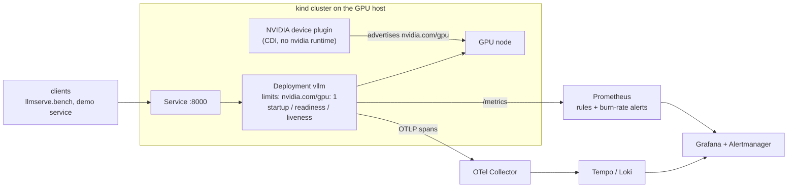

# LLM inference and GPU serving: vLLM on Kubernetes, quantization, speculative decoding, observability

[](https://github.com/mahmoudzahran01/llm-gpu-serving/actions/workflows/ci.yml)

What it takes to serve a small fine-tuned LLM well on one GPU, and to see what the server is doing. Everything was built and measured on a
single NVIDIA DGX Spark (GB10, 121 GB unified memory) running Qwen3-4B-Instruct-2507 with vLLM, using a text-to-SQL workload: a long
shared schema prompt plus a short question.

> **Headline numbers** (one shared GPU, single runs; read [the caveats](#reading-the-numbers-honestly) before quoting)
>
> * **Prefix caching** on a ~1.6k-token shared prompt: p50 time-to-first-token **13x lower** (3.43 s to 0.26 s) and **1.9x** the
>   throughput at 16 concurrent users.
> * **INT4 weights (GPTQ W4A16)** on the fine-tuned model: **3.0x smaller** (7.6 to 2.5 GB), **3.0x faster** for one user
>   (21 to 65 tok/s) and 2.7x at 16 users; execution accuracy 85.9% to 85.2% on a 297-question set (within noise). FP8: 2x faster.
> * **Speculative decoding** with a 0.6B draft model: **2.2x** single-user speed (20.7 to 45.3 tok/s), 66% of draft tokens accepted,
>   lossless by construction. N-gram lookup *hurt* under load (266 to 122 tok/s at 16 users).
> * **Kubernetes**: a Helm chart whose pod requests `nvidia.com/gpu: 1`, served through the NVIDIA device plugin in CDI mode without the
>   nvidia runtime or root, with raw evidence for what worked, what did not, and four real bugs along the way.
> * **Observability**: OpenTelemetry traces with the GenAI conventions, Prometheus metrics with trace exemplars, Grafana dashboards generated
>   from code, and multi-window burn-rate SLO alerts.

## What is in the repository

| Part | What it is |
|---|---|
| [`k8s/gpu/`](k8s/gpu/README.md) | Helm chart for vLLM on a GPU node, device-plugin values (CDI mode, time-slicing layer), `up.sh`/`down.sh`, one script per experiment, and the raw evidence from each (`evidence/20-32`): scheduling a 2-GPU pod on a 1-GPU node, rolling updates with one GPU, time-slicing, probes for a 4-minute start-up |
| [`src/llmserve/bench.py`](src/llmserve/bench.py) | Streaming load test for any OpenAI-compatible server: TTFT, TPOT and throughput per concurrency level, with a shared-prefix workload (`workload.py` builds a synthetic one) |
| [`src/llmserve/quantize.py`](src/llmserve/quantize.py) | Merge a LoRA adapter into a bf16 base, then FP8 / GPTQ W4A16 / NVFP4 with llm-compressor, calibrated on your own prompts |
| [`scripts/`](scripts/) | Sweeps that serve each variant with identical flags and benchmark it: quantization, speculative decoding, GGUF/llama.cpp |
| [`obs/`](obs/README.md) and [`src/llmserve/obs/`](src/llmserve/obs/) | Prometheus, Alertmanager, Grafana, Tempo, Loki and OTel Collector configuration; a small instrumented LLM service, load generator and GPU-memory exporter |
| [`results/`](results/RESULTS.md) | The measurements behind every number here, with the raw benchmark JSON |



## Results

Qwen3-4B-Instruct-2507, 32 streamed requests per concurrency level, one ~1.6k-token shared system prompt (a database schema), temperature 0.
Full tables, server flags and provenance: [`results/RESULTS.md`](results/RESULTS.md).

**Prefix caching and continuous batching** (BF16, KV cache 2.75 GiB):

| Concurrency | TTFT p50, cache on | TTFT p50, cache off | tok/s, cache on | tok/s, cache off |
|---:|---:|---:|---:|---:|
| 1 | 0.24 s | 0.48 s | 9.6 | 9.9 |
| 4 | 0.26 s | 0.65 s | 46.5 | 36.5 |
| 8 | 0.26 s | 0.70 s | 89.0 | 57.5 |
| 16 | 0.26 s | 3.43 s | 133.6 | 72.0 |

Continuous batching alone gives about 14x the throughput from 1 to 16 users with a flat time per token. Without prefix caching every
request re-prefills the schema and the small KV cache forces queueing and preemption (one preemption, 100 s of total queueing).

**Quantization of the fine-tuned model** (same server flags for every variant; accuracy is on a private 297-question text-to-SQL set):

| Variant | Size | Accuracy | tok/s, 1 user | tok/s, 16 users | TPOT p50, 1 user |
|---|---:|---:|---:|---:|---:|
| BF16 | 7.6 GB | 85.9 | 21.2 | 245 | 46.6 ms |
| FP8 dynamic | 4.2 GB | 84.5 | 41.2 | 401 | 24.0 ms |
| **GPTQ W4A16** | **2.5 GB** | 85.2 | **64.6** | **672** | **15.2 ms** |
| GGUF Q4_K_M (llama.cpp) | 2.5 GB | 85.5 | 60.4 | 199 | 15.4 ms |

* Single-stream decode is memory-bandwidth bound, so time per token tracks weight bytes (4-bit weights: 3.6x faster per token on the base model).
* llama.cpp matches vLLM for one user but not under batching (199 vs 672 tok/s at 16 users): good for edge and single-user, not for batched GPU serving.
* On the *base* model, NVFP4 (4-bit activations too) was the fastest at 16 users (295 tok/s) but lost 8 points of accuracy on the 49-question
  set, mostly Arabic; FP8 and W4A16 stayed within noise. A bilingual model needs per-language accuracy checks after quantization.
* The Arabic score dropped 2 to 5 points under 4-bit on the fine-tuned model (92.9 to 88.4 / 87.5). That is **not significant** on this
  set (p = 0.12 and 0.15), so it is a watch item, not a finding.

**Speculative decoding** (fine-tuned model, BF16): none 20.7 tok/s for one user, n-gram prompt lookup 24.1 (25% acceptance), **0.6B draft
model 45.3** (66% acceptance; 266 to 411 tok/s at 16 users). N-gram lookup collapsed throughput at 16 users (122 tok/s) because rejected
tokens waste batch capacity; it only pays when outputs copy long spans of the prompt.

**Kubernetes and the GPU** ([`k8s/gpu/README.md`](k8s/gpu/README.md)): a pod asking for 2 GPUs on a 1-GPU node stays `Pending` with
`Insufficient nvidia.com/gpu`; the default rolling-update strategy deadlocks on one GPU (the surge pod can never schedule) and
`maxSurge: 0` fixes it at the price of a 236 s outage; time-slicing turns 1 GPU into 2 slots with no memory isolation. The four bugs
that cost time: a per-uid inotify quota, `command:` bypassing the image ENTRYPOINT, a Service named `vllm` injecting `VLLM_PORT=tcp://...`,
and vLLM's start-up free-memory check on a shared GPU.

### Reading the numbers honestly

* **One shared machine, single runs.** Other model servers and a data-generation job were running on the GPU during the measurements. Absolute
  speeds are pessimistic, speed differences under about 15% are noise, and there are no repeats or intervals on speed numbers. The 3.0x and 2.2x
  figures are large enough to survive that; the ordering of FP8 and W4A16 at 16 users did not (W4A16 tied FP8 in the base-model sweep and led in the fine-tuned-model sweep).
* **Private workload and private accuracy sets.** The prompt, the questions and the accuracy sets come from a database schema that cannot be
  published. The synthetic workload in `llmserve.bench` shows the same effect but will not reproduce the absolute numbers.
  The accuracy sets are small (49 and 297 questions); the 297-question references are teacher-agreed results, not human labels. "No accuracy
  cost" means "within noise on these sets".
* **Scripts were generalised after the runs.** The sweep scripts and the benchmark client in this repository are the cleaned-up, parameterised
  versions of the ones that produced the numbers; they are syntax-checked and the client is unit-tested, but they have not been re-run on a GPU
  in this form.
* **Observability was adapted, not re-run.** The stack and the vLLM saturation drill were run for real (`obs/evidence/`). The demo service,
  the app dashboard and the SLO rules were rewritten to be generic for this repository and are covered by tests but have not been exercised
  against a live stack. See [`obs/README.md`](obs/README.md).
* **Lab shortcuts.** The Kubernetes work ran on a shared box without root, so it includes workarounds (driver files copied into a kind node,
  a world-writable kubelet socket, the plugin run as a non-root uid) that are explained and flagged as not production practice. There is no
  multi-GPU, tensor-parallel, GPU Operator or autoscaling coverage.

## Run it

**Tests and linters (CPU only, no GPU):**

```bash
python -m venv .venv && source .venv/bin/activate
pip install -e ".[dev]"
make test lint
```

**Benchmark your own vLLM** (any OpenAI-compatible server works):

```bash
vllm serve Qwen/Qwen3-4B-Instruct-2507 --served-model-name m --enable-prefix-caching --max-model-len 6144
python -m llmserve.bench --base-url http://localhost:8000/v1 --model m --levels 1,8,16 --requests 32 --tag baseline
# your own prompt and questions: --system-prompt-file prompt.txt --questions-file questions.jsonl
```

**Quantize and sweep** (GPU; see [`docker/quant.Dockerfile`](docker/quant.Dockerfile) and [`scripts/`](scripts/)):

```bash
python -m llmserve.quantize merge --base Qwen/Qwen3-4B-Instruct-2507 --adapter runs/qlora/adapter --out runs/merged
python -m llmserve.quantize quant --model runs/merged --scheme w4a16 --calib-file data/train.jsonl --system-prompt-file prompt.txt
scripts/quant_sweep.sh final runs/merged runs/merged-w4a16        # same server flags for every variant, then bench
scripts/spec_decode_sweep.sh runs/merged                          # none vs n-gram vs 0.6B draft
```

**Kubernetes and observability:** follow [`k8s/gpu/README.md`](k8s/gpu/README.md) (needs a GPU host, Docker, kind, kubectl and helm) and
[`obs/README.md`](obs/README.md).

## Related

[`bilingual-text-to-sql`](https://github.com/mahmoudzahran01/bilingual-text-to-sql) produced the fine-tuned model served here.

## Licence

MIT, see [`LICENSE`](LICENSE). Model weights, the vLLM image and the NVIDIA components carry their own licences.
