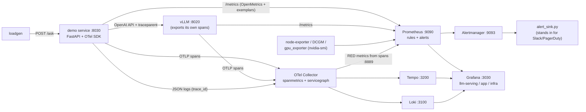

# Observability for LLM serving: traces, metrics, logs, dashboards, alerts

A single-host stack that watches an LLM-backed service and the vLLM server under it with OpenTelemetry, Prometheus, Grafana,
Tempo, Loki and Alertmanager, built and exercised on a DGX Spark (aarch64, GB10).

> **What was verified, and what was not.** The stack, the vLLM dashboard and the saturation drill (B) were run on 2026-11-02;
> `evidence/B-vllm-saturation-metrics.txt` holds the PromQL results of that drill. The original run used a larger demo service
> (a text-to-SQL agent with retrieval over a private schema) whose evidence is not published. For this repository the service was
> replaced by the small generic one in `src/llmserve/obs/demo_app.py` and the app dashboard, recording rules and alerts were adapted to
> it. Those adapted parts are covered by unit tests (span attributes, metrics, fault path, rule/dashboard consistency) but **have not
> been re-run end to end against a live stack**. Expect to fix small things when you first run drill S.

## Architecture



| Piece | Port | Notes |
|---|---|---|
| Grafana 12.1 | 127.0.0.1:3030 | admin password from `obs/.env`; anonymous visitors get a read-only Viewer role (loopback only) |
| Prometheus 3.5 | 127.0.0.1:9090 | 5 s scrape, exemplar storage on, rules and alerts |
| Alertmanager 0.28 | 127.0.0.1:9093 | webhook receiver is `scripts/alert_sink.py` |
| OTel Collector (contrib 0.131) | 4317/4318 (+ docker0 gateway 4317), 8888, 8889 | traces, span-derived RED metrics, log shipping |
| Tempo 2.8, Loki 3.5 | 3200, 3100 | trace and log backends |
| node-exporter, DCGM exporter 4.5, `exporters/gpu_exporter.py` | 9100, 9400, 9401 | host, GPU, per-workload GPU memory |
| demo service | 8030 | `llmserve.obs.demo_app:create_app` (answer, then summarize: two LLM calls) |
| vLLM | 8020 | `scripts/run_obs_vllm.sh` |

Everything listens on loopback; use an SSH tunnel (`ssh -N -L 3030:127.0.0.1:3030 -L 9090:127.0.0.1:9090 host`) to look at it.
There is no TLS, SSO, per-tenant auth or secret rotation: this is a lab stack, not a production deployment.

## Run it

```bash
cp obs/.env.example obs/.env && $EDITOR obs/.env          # set GRAFANA_ADMIN_PASSWORD
pip install -e ".[dev]"                                    # demo service, loadgen, tests
obs/scripts/run_obs_vllm.sh                                # vLLM with tracing on :8020 (needs a GPU and Docker)
obs/scripts/up.sh                                          # compose stack + gpu exporter + alert sink + demo service
python -m llmserve.obs.loadgen --phases "1:45,2:45,4:60"   # baseline ramp
obs/scripts/scenarios.sh B                                 # drill B: saturate vLLM
obs/scripts/scenarios.sh S                                 # drill S: stalled backend -> 5xx -> burn-rate alerts
obs/scripts/down.sh                                        # stop (data in obs/data is kept); `down.sh all` also stops vLLM
```

Dashboards are **generated** (`obs/scripts/gen_dashboards.py` -> `obs/grafana/dashboards/*.json`; `make dashboards`), so the PromQL
is what you review, not JSON boilerplate. A test fails if the committed JSON differs from the generator's output.

## What to watch when serving an LLM

An LLM request has two phases that users feel differently:

| Metric | Phase | Measures | Gets worse when |
|---|---|---|---|
| **TTFT** | queue + prefill | wait before anything appears | load exceeds capacity, long prompts, prefix-cache misses |
| **TPOT / inter-token latency** | decode | gap between streamed tokens (1/TPOT = tokens/s per user) | big batches, GPU contention (memory-bandwidth bound) |
| **E2E latency** | all | TTFT + output tokens x TPOT | long answers |
| **Throughput** | system | tokens/s and requests/s delivered | poor batching |

* **Queue** (`vllm:num_requests_waiting`) is the saturation signal: waiting > 0 means demand exceeds capacity, and every waiting request
  adds queue time to its TTFT.
* **KV cache usage** bounds concurrent tokens. At 100% requests wait or are **preempted** (evicted and later recomputed, so their work is
  thrown away). Any non-zero preemption rate is a capacity bug.
* **Prefix-cache hit rate** shows whether a long shared prompt is actually being reused. A drop means the shared prefix changed, is no
  longer first, or the cache is thrashing.
* **Finish reasons**: `length` means truncated at `max_tokens`, a quality failure that hides behind HTTP 200.
* **Measure client-side and server-side.** The server cannot see network or client queueing, and the client cannot see vLLM's internal
  queue. The demo service streams, so it records its own TTFT next to vLLM's.
* **Metric names drift between vLLM versions** (`vllm:kv_cache_usage_perc` vs older `vllm:gpu_cache_usage_perc`). Check `/metrics` of
  the exact version you run; a dashboard that shows "No data" is usually this.
* **GB10 specifics.** CPU and GPU share one unified memory pool, so the host-memory alert is also the GPU-memory alert; DCGM works for
  utilisation, power, temperature and clocks but reports no framebuffer or per-process memory, which is why `exporters/gpu_exporter.py`
  wraps `nvidia-smi --query-compute-apps`.

## Drill B: vLLM saturation (recorded)

24 concurrent, long, *unique* prompts (they defeat the prefix cache) straight at one vLLM server for 150 s
(`evidence/B-vllm-saturation-metrics.txt`):

| Signal | Observed |
|---|---|
| KV cache usage | 99.8%, above 90% for minutes |
| running / waiting requests | 12 running, up to 21 waiting |
| TTFT p95 (server side) | up to 156 s (about 0.9 s once the load stopped) |
| mean queue time | up to 80 s |
| preemptions | 4 |
| prefix-cache hit ratio | 0.7% (unique prompts) |

`LLMTimeToFirstTokenHigh`, `LLMRequestQueueGrowing`, `LLMKVCacheNearFull` and `LLMPreemptionsDetected` fired. The lesson: the latency
was queue, not compute. A trace of one request showed `time_in_queue` of 53.6 s, prefill of 2.2 s and decode of 61.7 s in a 118.5 s
request. Saturation appears in the queue and KV gauges before any error does. (Alert timeline and trace JSON from the run are not
included.)

## SLOs and burn-rate alerts

The service SLO is **99% of `/ask` requests succeed** (5xx is the failure signal), so the error budget is 1%. *Burn rate* is the
error ratio divided by 0.01: 1 spends the budget exactly on schedule, 14.4 exhausts a 30-day budget in about 2 days.
`prometheus/rules/alerts.yml` uses the multi-window, multi-burn-rate pattern: the fast alert needs both the 1 h and 5 min error ratios
above 14.4 x 1% (a long window says "significant", a short one says "still happening", so the alert resets quickly after a fix); the
slow alert needs 6 h and 30 min above 6 x 1%. Lab `for:` durations are short so alerts can be triggered in minutes; each rule's
`prod_hint` annotation gives the production value. The ratios are recording rules (`prometheus/rules/recording.yml`) with an
`or vector(0)` on the numerator, without which the ratio vanishes while no 5xx series exists yet.

## Cardinality and privacy choices

* Metric labels come from small fixed sets (route *template*, stage, outcome, error class). Never a user id, question text or trace id;
  the trace id travels as an **exemplar** instead.
* Prompt and completion capture on spans is **off by default** (`OTEL_GENAI_CAPTURE_CONTENT=true` turns it on) because prompts can
  contain customer data. Redact in the collector before enabling it anywhere real.
* Tail sampling (keep every error and slow trace, sample the rest) is described in a comment in `otel/collector.yml` and disabled here,
  because the lab wants every trace.

## Layout

```
obs/
  docker-compose.yml  .env.example
  prometheus/{prometheus.yml, rules/{alerts,recording}.yml}  alertmanager/  otel/collector.yml  tempo/  loki/
  grafana/{provisioning/, dashboards/*.json}        exporters/gpu_exporter.py
  scripts/  up.sh down.sh app.sh run_obs_vllm.sh scenarios.sh capture.sh
            gen_dashboards.py  q.py trace_tree.py shoot.py evidence_dump.py alert_timeline.py alert_sink.py
  evidence/B-vllm-saturation-metrics.txt
src/llmserve/obs/  demo_app.py telemetry.py metrics.py genai.py loadgen.py
```

## Not covered

Multi-tenant cost attribution, long-term storage (Mimir/Thanos), a real paging integration, log redaction pipelines, profiling-grade GPU
counters (`DCGM_FI_PROF_*`), and multi-GPU or multi-node serving.
